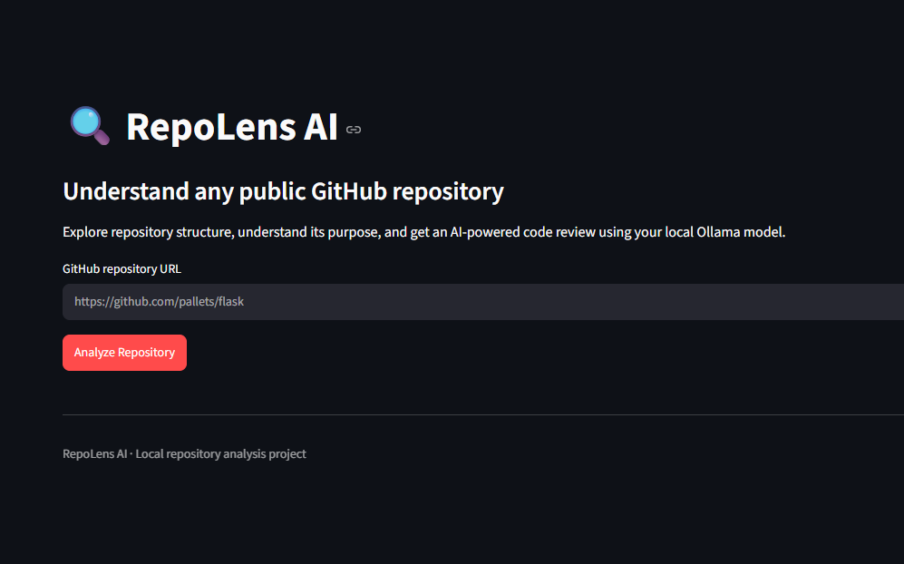
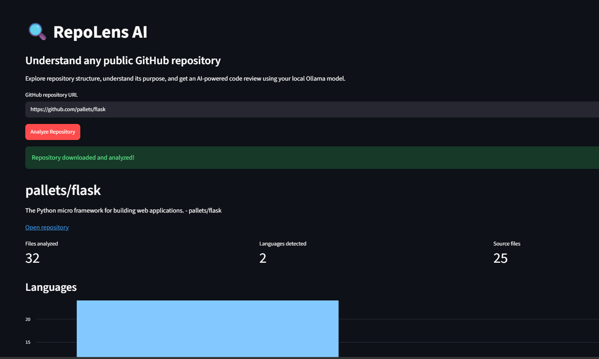
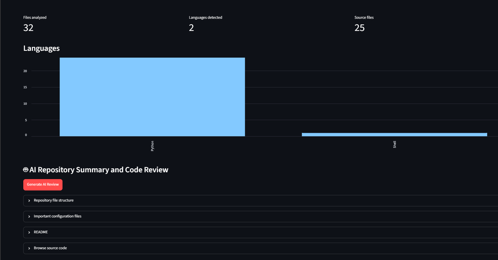
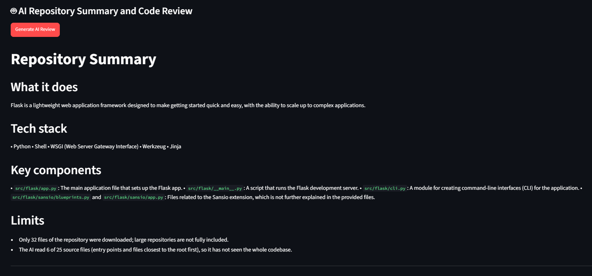
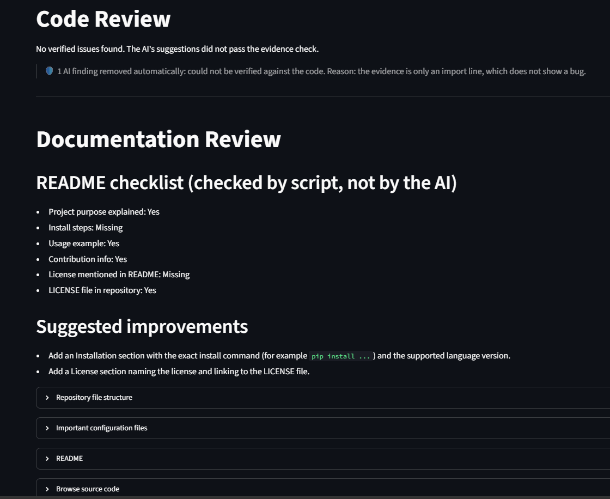

# RepoLens AI

RepoLens AI is an AI-powered tool that analyzes public GitHub repositories and generates code review feedback and documentation improvement suggestions using a locally running language model.

## 1. Problem Statement

Understanding and reviewing an unfamiliar codebase can be time-consuming. Developers need to inspect files, identify potential issues, verify findings, and check whether documentation is complete. Manual code review requires significant effort, while unsupported AI-generated findings can mislead developers.

RepoLens AI aims to simplify this process by combining repository analysis with AI-generated feedback supported by code evidence.

## 2. Solution

RepoLens AI provides a web-based interface for analyzing public GitHub repositories.

The implemented features include:

- Fetching and analyzing public GitHub repositories.
- Selecting relevant files for analysis.
- Generating AI-assisted code review feedback.
- Using evidence-grounded prompts to improve the reliability of findings.
- Checking findings to reject unsupported results based only on function signatures.
- Reviewing documentation and suggesting improvements.
- Displaying progress while generating reviews.
- Running AI review generation locally through Ollama.
- Launching the application on Windows using `run_app.bat`.

## 3. Technology Stack

- **Language:** Python
- **Web framework:** Streamlit
- **Local language model runtime:** Ollama
- **Language model:** Llama 3.2 (3B)
- **HTTP requests:** Requests
- **Testing:** Pytest
- **Version control:** Git and GitHub

## 4. Architecture

RepoLens AI follows this workflow:

```text
User
  |
  v
Streamlit Web Interface
  |
  v
GitHub Repository URL
  |
  v
Repository Retrieval and File Selection
  |
  v
Repository Analysis
  |
  v
Evidence-Grounded AI Review
  |
  v
Local Ollama Language Model
  |
  v
Code Review Findings and Documentation Suggestions
  |
  v
Results Displayed to User
```

The Streamlit interface accepts a public GitHub repository URL. The repository utilities retrieve files, the analyzer examines the selected code, and the AI review component generates feedback using the local language model. The results are then displayed in the application.

## 5. Setup Instructions

### Prerequisites

- Python 3.11 or a compatible version.
- Git.
- Ollama installed on the system.

### Step 1: Clone the repository

```bash
git clone https://github.com/MashaalFarrukh-max/local-ai-commit-generator.git
cd local-ai-commit-generator
```

### Step 2: Create a virtual environment

On Windows, run:

```powershell
python -m venv .venv
.venv\Scripts\Activate.ps1
```

### Step 3: Install dependencies

```bash
pip install -r requirements.txt
```

### Step 4: Download the language model

```bash
ollama pull llama3.2:3b
```

Ensure Ollama is running before generating an AI review.

### Step 5: Run the application

On Windows, double-click `run_app.bat`.

Alternatively, run:

```bash
python -m streamlit run app.py
```

### Step 6: Run tests

To run the prompt verification tests:

```bash
python -m pytest test_prompts.py -v
```

## 6. Demo

The following screenshots demonstrate the RepoLens AI application. The image paths refer to files stored in the `screenshots` folder.

### Application Interface



### Code Review



### Repository Analysis



### Documentation Review



### Additional Application View



## 7. Team Contributions

- **[MashaalFarrukh-max]:** Repository integration, prompt verification and regression testing, Windows launcher, README preparation, and application testing.
- **Sara ([si66326h-cmyk]):** Evidence-grounded prompts and finding verification, focused prompts, review progress support, README selection improvement, prompt comparison script, and Streamlit session-state fix.


## 8. License

This project is licensed under the MIT License. See the [LICENSE](https://github.com/MashaalFarrukh-max/local-ai-commit-generator?tab=MIT-1-ov-file) file for details.

## 9. Acknowledgements

We acknowledge the developers and maintainers of the following tools and libraries used in this project:

- **Streamlit** for the web application interface.
- **Ollama** for running the language model locally.
- **Meta AI** for the Llama 3.2 model.
- **Python** for the application logic.
- **Requests** for HTTP communication.
- **Pytest** for automated testing.
- **Git and GitHub** for version control and project collaboration.
